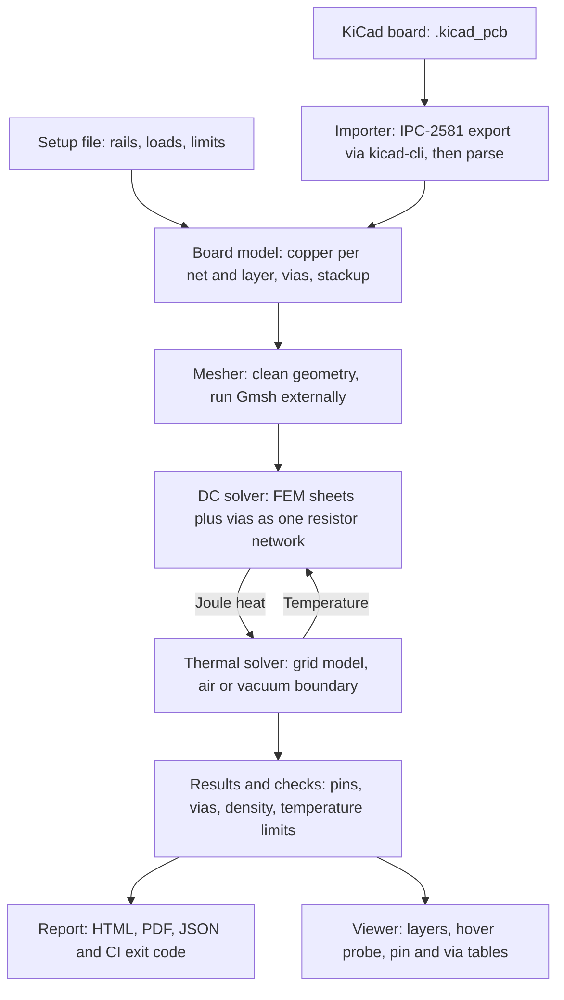

# PDNLab DC: Development Plan

Last updated 2026-11-15. This file is the working copy of the plan.

Converted from the supplied `PLAN.md.pdf`. Experiment results are recorded in
[DECISIONS.md](DECISIONS.md). `LANDSCAPE.md` is a companion document that is not
yet in this repository.

## Goal and decisions

PDNLab DC is an open-source DC power-integrity solver for PCBs, written from
scratch, reading KiCad boards first. Version 1 covers IR drop, via and pin checks,
electro-thermal coupling, a sign-off report and an interactive viewer.

| Decision | Choice | Consequence |
| --- | --- | --- |
| Release model | Open source, Apache-2.0 | Anyone can use, change or embed the tool. The LICENSE file goes in on day one, so every contribution arrives under it. |
| Solver core | Own code, no padne or KiPI code | Full control over via models and licence. Existing tools are used only as references for cross-checks. |
| First input | KiCad 10 | Importer is an adapter onto a neutral board model, so Altium and OrCAD X can follow without touching the solver. |
| Version 1 features | Via and pin checks, electro-thermal, sign-off report, interactive viewer | Roughly 23 working weeks for one developer (estimate). Only the first 9 weeks are committed; the rest is backlog. |

Committed scope is the MVP: phases 0 to 2, ending in release 0.1. That is a
command-line DC drop solver for KiCad 10 boards, with results viewed in ParaView.
With under 5 hours a week available, checks, report, thermal and viewer are a
backlog to re-decide after release 0.1. The MVP alone is an estimated 360 hours.
At 2 to 5 hours a week that is roughly 1.4 to 3.5 years, so phase 0 is split into
small experiments with a reassessment after each.

## Scope

Version 1 is a steady-state DC and thermal tool for one board. Anything
frequency-dependent or nonlinear is out. The performance target for 1.0 is a
medium board: up to about 200 × 200 mm, 8 to 12 layers, some BGAs.

| Area | In version 1 | Out, later |
| --- | --- | --- |
| Electrical solve | All layers, power and return nets solved together, any number of rails | AC impedance, decoupling optimisation, transients, skin effect, full 3D |
| Sources and loads | Voltage source with series resistance, regulator with remote sense, constant-current sink, resistive sink | Constant-power loads, converter efficiency linking input current to output power |
| Series parts | Resistors, inductor DCR, ferrites, fuses, FET on-resistance joining nets into one power tree | Automatic value lookup from part numbers |
| Results | Voltage, drop, current density and power density per layer; voltage per pin; current per via | — |
| Checks | Pin voltage window, via current, current density, temperature rise, each with pass or fail | Rule import from KiCad net classes |
| Thermal | Steady state, Joule heat plus component dissipation, air or vacuum boundary | Transient thermal, airflow simulation |
| Output | HTML and PDF report, JSON results, CLI exit code for CI, desktop viewer | Overlay inside the KiCad canvas |
| Input | KiCad 10 boards | Altium, OrCAD X, multi-board, packages |

## Architecture

The solver is a pipeline around one neutral board model. Only the importer knows
KiCad, so Altium or OrCAD X later means a new importer, not a new solver.

The DC and thermal solvers repeat (heat down, temperature up) until the result is
stable.

**Ingestion.** Maintainer-confirmed route (2026-11-15): `kicad-cli pcb export ipc2581`, then parse the
XML. Three reasons:

- The SWIG `pcbnew` bindings are deprecated since KiCad 9.0, with removal planned
  for KiCad 11.0 (KiCad developer docs).
- `kicad-cli` needs no GUI, so the same command runs on a CI runner (KiCad 10 CLI
  reference).
- IPC-2581 is the intended common format for later Altium and OrCAD X adapters.
  Compatibility with their exports has not been tested.

The phase 0 KiCad export audit and real-net comparison are recorded in
`DECISIONS.md`. The direct `.kicad_pcb` reader remains an experimental cross-check.
Electrical pin types and thermal-relief gap metadata are not supplied by the
experimental export reader; loads must be explicit and meshing must account for
relief geometry. These are implementation requirements for phase 2.

**Setup file.** Sources, sinks, series parts and limits live in a TOML file next
to the board. It is version-controlled and reviewable in a pull request. KiCad
symbol fields can generate it later.

**Results.** The solver writes one results bundle: mesh fields plus JSON. Report
and viewer only read it, so both can change without re-solving.

## Physics and numerical method

At DC a board is a stack of thin resistive sheets joined by via barrels. Each
sheet is solved with 2D finite elements; vias and parts are lumped resistors in
the same matrix.

Think of the mesh as a very large resistor network. Each triangle contributes
three resistors, and the global matrix is the same nodal conductance matrix
LTspice builds. Finite-element assembly is just stamping.

$$
\nabla \cdot \big(\sigma(T)\,t\,\nabla\varphi\big)=0,
\qquad \mathbf{J}=-\sigma\nabla\varphi,
\qquad q=\sigma\,t\,|\nabla\varphi|^2
$$

Here φ is voltage, σ copper conductivity, t layer thickness, J current density
and q heat per unit area.

| Element | Model | Reason |
| --- | --- | --- |
| Copper sheet | Linear triangles, one voltage per node, sheet conductance σ(T)·t per layer | Resolves neck-downs and thin traces with few unknowns |
| Via | One rim node per contacted layer: on each layer the via touches, all mesh nodes on the hole rim are tied to that layer's rim node. Rim nodes of successive contacted layers are joined by barrel resistors. | Current injected at a single mesh node gives a drop that changes with mesh size; a tied rim does not. One node shared by all layers would short out the barrel. |
| Component pin | Per-pin choice: soldered pad as an equipotential, or contact point/area at an explicit position; optional contact resistance | Maintainer-approved on 2026-11-15. Unsoldered contacts do not short the whole pad. A mathematical point in a 2D sheet needs special treatment because its local voltage depends on mesh size. |
| Source, regulator | Fixed voltage between pin groups; with remote sense the constraint moves to the sense pins | Matches how a real regulator holds its feedback node |
| Sink | Fixed current, shared between pins by the solve or forced equal per pin | Both cases occur: BGA balls share, separate connectors do not |
| Series part | Lumped resistor between two pin groups | Joins nets into one power tree |

$$
R_{via}=\frac{\rho(T)\,L}{\pi\,(r_o^2-r_i^2)}
$$

L is the distance between the centres of two successive contacted layers. r_o is
the outer radius of the copper barrel and r_i its inner radius, so r_o − r_i is
the plating thickness.

**Hole dimensions.** A board file gives one hole diameter d, and it can mean two
things. The setup file states which one applies; the default is finished hole.

| Meaning of d | r_i | r_o |
| --- | --- | --- |
| Finished hole, after plating (default) | d/2 | d/2 + plating |
| Drill, before plating | d/2 − plating | d/2 |

For a 0.3 mm hole with 25 µm plating, the two readings differ by about 18% in
barrel resistance. The hole in each layer's mesh uses r_o, where the copper
sheet meets the barrel. Plating thickness is a setup value. Its default, and
which meaning KiCad 10 exports, are checked in phase 0.

### Linear solve

Two separate questions decide how the system is solved.

**Is it solvable at all?** Every connected piece of the network that is solved
must contain at least one node with a fixed voltage. A piece without one gives
a singular matrix, and no solver fixes that, LU included. Such pieces are
removed or rejected by the floating-copper pass below, before any matrix is
built.

**Which kind of matrix is it?** For a referenced network, that depends on the
sources:

| Sources in the network | Matrix | Solver |
| --- | --- | --- |
| Fixed voltages to the reference, current sinks, resistors; rim ties applied by merging nodes | Symmetric positive definite | Direct sparse solve for small boards, conjugate gradient with algebraic multigrid for large ones |
| Ideal two-terminal voltage source between two unfixed nodes, added as a constraint row | Symmetric indefinite | Sparse LU |
| Regulator with remote sense: the output is driven until the sense pins reach the setpoint | Nonsymmetric | Sparse LU |

The MVP starts with the first row only: one reference per network, with each
source's return terminal at that reference. Sources with different return
points need the second row, and regulators in the backlog need the third.
Multigrid keeps memory roughly proportional to node count. A user reported
padne being killed on a 220 × 200 mm board with 8 GB; direct-solver memory growth
is a likely cause, though not a confirmed one.

### Floating copper

Before assembly, a connected-component pass runs over the whole network:
meshes, vias and lumped parts.

- A piece with no fixed voltage and no source or sink is left out of the solve
  and reported as floating, with its voltage undefined.
- A piece with a source or sink but no fixed voltage is an error, because its
  voltage level is undetermined. The solver stops and names the nets.
- Disconnected islands of a power net, such as orphaned zone fragments, are
  listed in the results.

### Electro-thermal coupling

A second solve runs on a uniform grid over the whole board, starting at about
0.5 mm cells. Temperature is smooth and spreads through dielectric, so it needs
the full board but not a fine mesh.

- Each cell gets in-plane conductivity from its copper fraction per layer, and
  through-plane conductivity from dielectric and via barrels.
- Heat sources are Joule heat from the DC solve plus component dissipation from
  the setup file.
- Air mode: convection coefficient and radiation on both faces.
- Vacuum mode: radiation and fixed-temperature mounting points only. This is
  the case that matters for space hardware.
- Copper resistivity follows temperature, and the two solves repeat until the
  largest change is below 0.1 K.

$$
\rho(T)=\rho_{20}\big[1+\alpha(T-20\,^{\circ}\mathrm{C})\big],
\qquad \alpha\approx0.0039\ \mathrm{K^{-1}}
$$

## Technology stack and licensing

Python with NumPy and SciPy is the recommended core. The heavy maths already
runs in compiled libraries, and Python is the fastest route to a working,
testable solver. Hot spots can move to Rust or C++ once profiling shows where
they are.

| Layer | Choice | Licence |
| --- | --- | --- |
| Core language | Python 3.11+, NumPy, SciPy | BSD |
| Geometry | Shapely 2 for unions, clipping and cleanup | BSD (GEOS underneath is LGPL) |
| FEM assembly | Own vectorised code; scikit-fem as an independent check in tests | Own; BSD |
| Linear solver | SciPy SuperLU direct, PyAMG multigrid for large boards | BSD; MIT |
| Thermal | Own finite-volume code on a NumPy grid | Own |
| Results | VTU through meshio, plus JSON | MIT |
| Viewer | PyVista on VTK in a Qt window (PySide6) | MIT; BSD; LGPL |
| Report | Jinja2 HTML template, WeasyPrint for PDF | BSD |
| Tooling | Typer CLI, uv, pytest, GitHub Actions | MIT |

The current installed dependency inventory and packaging boundaries are recorded
in [dependency-license-audit.md](dependency-license-audit.md). Future/backlog
packages in the table are not covered until they are added; their licences and
the exact release artifact must be reviewed then.

**Licence: Apache-2.0, decided.** The goal is that anyone can use the tool
without restrictions, including inside other products. Users only have to keep
the copyright notice.

**Mesher: Gmsh, run as an external program, decided.** The solver never imports
Gmsh. It writes a geometry file, calls the `gmsh` executable and reads the mesh
file back. Gmsh is GPL, but programs that only exchange files are generally
treated as separate works, so the solver stays Apache-2.0. KiCad is handled the
same way through `kicad-cli`. This is the common reading, not legal advice.

1. Write one `.geo` file per net and layer: copper outline, cut-outs, via holes
   and pad edges.
2. Tag every via rim and pad edge as a named physical group, so the solver can
   find those nodes again.
3. Set mesh size by distance: fine near vias, pads and neck-downs, coarse in open
   plane.
4. Run `gmsh net_layer.geo -2 -format msh4 -o net_layer.msh`.
5. Read the result with meshio and hand the triangles to the assembler.

Each file meshes in its own process, so layers run in parallel at no extra cost.
Users install Gmsh themselves; the project does not bundle it. Every results
file records the Gmsh version used.

The mesher still sits behind a small interface: polygons in, triangles out.
Netgen (LGPL) is the in-process alternative if the file round trip ever becomes
a bottleneck. Triangle stays ruled out by its licence, as KiPI notes.

## Phases and milestones

Seven phases, about 23 full-time working weeks. Phases 0 to 2, about 9 weeks or
360 hours, are committed. Phases 3 to 6 are backlog, re-decided after release
0.1. Effort is full-time working weeks for one developer, estimated.

| Phase | Effort | Work | Gate | Exit criterion |
| --- | --- | --- | --- | --- |
| 0 Experiments (committed) | 2 weeks | Eight small experiments, listed below, each with its own pass criterion. Reassess after each one. | Decisions recorded | Importer and mesh pipeline chosen; every experiment passed or its failure understood |
| 1 Solver core (committed) | 3 weeks | FEM on plain polygons, lumped parts, sources and sinks. No board files yet. | Analytic tests pass | Within 0.5% in CI |
| 2 Real boards (committed) | 4 weeks | Importer, board model, mesher on real copper, via model, setup file, VTU output. | Release 0.1 | All six release 0.1 gates below |
| 3 Checks and report (backlog) | 3 weeks | Series parts, regulators with sense, checks, HTML, PDF and JSON report, CI exit code. | Release 0.2 | Gates a pull request |
| 4 Electro-thermal (backlog) | 4 weeks | Thermal grid, coupling loop, air and vacuum modes, component heat. | Release 0.3 | Energy balance within 1% |
| 5 Viewer (backlog) | 3 weeks | Desktop viewer with layer toggles, hover probe, pin and via tables. | Release 0.4 | Usable without ParaView |
| 6 Validation (backlog) | 4 weeks plus fab time | Test board with Kelvin points, measurements, commercial-tool comparison, docs, packaging. | Release 1.0 | Measured error published |

Each phase ends at a gate. The next phase does not start until the gate's
criterion is met. The percentages are proposed targets, not measured results.

### Phase 0 closeout (2026-11-15)

The experiment evidence and maintainer choices are recorded in `DECISIONS.md`.
IPC-2581 is confirmed; per-pin soldered/contact models are approved; KiPI is
removed from the required reference runs. The dependency inventory is complete
for the current local source workflow, with platform/build/packaging limits
stated in `dependency-license-audit.md`.

Recommendation: close phase 0 by reviewing and merging `exp8-ipc2581-route`,
then start phase 1 on a separate branch. No additional numerical experiment is
recommended before that transition. Contact implementation, production import
coverage and release-0.1 validation remain phases 1/2 work.

### Phase 0 experiments

Each experiment is small enough for one or two sittings. After each one, record
the result in `DECISIONS.md` and decide: continue, change approach, or stop.
Effort figures are rough guesses.

| # | Experiment | Pass criterion | Rough effort |
| --- | --- | --- | --- |
| 1 | Plain rectangle on a hand-made triangle mesh, no Gmsh. Fixed voltages on both ends; current taken from the reaction at the fixed nodes. | Relative error abs(R − R_ref) / R_ref ≤ 1e-6, with R_ref = ρL/(Wt). Linear elements represent a uniform field exactly, so any larger error is a bug. | 3 h |
| 2 | The same rectangle through the Gmsh round trip: .geo out, gmsh call, .msh in, end edges found by their tags. | Same result as experiment 1. Command-line flags and tag handling confirmed. | 3 h |
| 3 | Annular ring: inner rim tied to one rim node, outer rim at a fixed voltage. | Relative error ≤ 0.5% against ρ/(2πt)·ln(b/a), and the error shrinks when element size is halved. | 4 h |
| 4 | Two rings on two layers, joined at their inner rims by one barrel resistor. | Relative error ≤ 0.5% against ring + barrel + ring. Confirms one rim node per layer. | 3 h |
| 5 | Current conservation and power balance added as checks to experiments 1 to 4. | Both pass with the tolerances defined under the release 0.1 gates. | 2 h |
| 6 | Export one real KiCad 10 board to IPC-2581 and inspect the file. | Zone fills, stackup thickness, pin-to-net data and hole sizes are present, or the fallback parser is chosen. | 3 h |
| 7 | Run padne on the real-board comparison case. KiPI dropped by the maintainer on 2026-11-15. | Reference voltages recorded; setup and terminal-model differences explained. | 4 h |
| 8 | One net and layer of the real board through geometry cleanup and Gmsh. | It meshes, or the failure mode is understood. | 5 h |

The plain rectangle and the via geometry are separate tests on purpose. A hole
changes the resistance of a strip, so a strip with a hole cannot be compared
with the plain strip formula.

### Release 0.1 gates

All six must hold before release 0.1. Every tolerance has a relative part and an
absolute floor, so a quantity near zero cannot pass or fail by accident. Each
relative part names what it is measured against. The values are proposed
starting points.

| Gate | Check | Passes when |
| --- | --- | --- |
| 1 Analytic | Every analytic test | Each test meets its own relative-error limit |
| 2 Current conservation, global | Total source current against total sink current | abs(difference) ≤ 1 nA + 1e-6 × total source current |
| 3 Current conservation, per via | Kirchhoff's current law at every via rim node, on every contacted layer: sheet current into the rim plus the currents in the barrel segments above and below | abs(sum) ≤ 1 nA + 1e-6 × sum of the absolute currents at that node |
| 4 Power balance | Power delivered at the source terminals against copper loss plus loss in lumped parts | abs(difference) ≤ 1 nW + 1e-6 × power delivered |
| 5 Mesh convergence | Each pin voltage drop on the real test board, before and after halving the element size | abs(change) ≤ 10 µV + 1% × abs(drop) |
| 6 Cross-check with padne | Each pin voltage drop on the same board | abs(difference) ≤ 50 µV + 5% × abs(drop), or the difference is explained |

Gate 3 checks every layer node separately because a via can branch: current may
enter or leave the barrel at an intermediate layer. The 1e-6 factors assume a
direct solve; with an iterative solver they become ten times the solver's
relative tolerance if that is larger. padne is not known to be validated
either, so gate 6 is a cross-check, not proof of accuracy.

- At 2 to 5 hours a week, the 360-hour MVP is roughly 1.4 to 3.5 years. AI-written
  code may speed up implementation, but it does not shorten validation:
  reference runs, review and judging results take the same time either way.
  Re-estimate after each phase 0 experiment.
- Phases 4 and 5 can swap, or run in parallel once a second contributor joins.
  They share only the results bundle.
- Order the phase 6 test board during phase 4, so fabrication lead time runs in
  parallel.

## Validation strategy

No published accuracy validation was found for any open tool in the sources
checked (see `LANDSCAPE.md`), so validation is treated as a feature of this
project, not a late test task. Six levels, each catching what the one before
cannot.

| Level | Reference | Catches | Target | When |
| --- | --- | --- | --- | --- |
| 1 Analytic | Closed-form cases: straight strip, annular ring, via chain, 1D thermal fin | Assembly and unit errors | 0.5% relative, 1e-6 for the plain strip | CI, every commit |
| 1b Self-consistency | Current conservation and power balance | Bookkeeping errors in terminal currents, via currents and loss integration | 1e-6 relative plus an absolute floor, as in gates 2 to 4 | Every solve |
| 2 Mesh convergence | Same case at half the element size | Under-resolved geometry | 1% of the drop plus 10 µV | CI, every commit |
| 3 Full 3D | Small coupon solved in 3D with Elmer | Via and pad model error | 3% relative | Each model change |
| 4 Other tools | padne; a PowerDC trial if one can be arranged later | Importer and setup mistakes on real boards | 5% of the drop plus 50 µV | Each release |
| 5 Measurement | Own test board, four-wire | Everything, including material assumptions | Publish the number | Once, for 1.0 |

The two analytic cases that carry most of level 1, a strip of length L and width
W and a ring between radii a and b:

$$
R_{strip}=\frac{\rho\,L}{W\,t},
\qquad R_{ring}=\frac{\rho}{2\pi t}\ln\frac{b}{a}
$$

### Test board

- Structures: straight traces in three widths, a neck-down, a plane fed through
  a via array, a via daisy chain, thermal-relief spokes.
- Kelvin pads on every structure. Drive 1 to 10 A from a bench supply and read
  the drop with a 6.5-digit meter.
- A calibration strip on every layer. Finished copper thickness differs from
  nominal and plating adds to outer layers. Without a sheet-resistance
  measurement from the same panel, fab tolerance cannot be told apart from
  model error.
- Thermal: thermocouples or an infrared camera in air. No thermal-vacuum chamber
  is available, so vacuum mode is checked against analytic and 3D cases only
  and labelled as unmeasured.

padne's NLnet grant also funds measured test boards. If that data is published,
it is a free independent data set.

## Risks and open questions

The biggest risk is scope, not physics. The solver maths is well understood;
real board geometry and one person's time are what can sink this.

| Risk | Why it is real | Mitigation |
| --- | --- | --- |
| Scope too large for one person | Four version 1 features plus an own solver is about 23 full-time weeks | Only phases 0 to 2 are committed. Everything after release 0.1 is backlog. |
| Mesher fails on real copper | padne users hit crashes from tiny notches in real boards (forum thread) | Geometry cleanup before meshing. Run every open KiCad board you can find in CI. |
| Via and pad models inaccurate | padne's author doubts his own via model in the same thread | Level 3 coupon in full 3D, then level 5 measurement |
| Memory and runtime on large boards | padne was killed on a 220 × 200 mm board with 8 GB | Multigrid solver from the start, coarser mesh away from small features |
| IPC-2581 export coverage varies | KiCad route confirmed on one net; other CAD exports and unsupported geometry remain untested | Explicit unsupported-content errors, geometry audits and broader importer fixtures in phase 2. |
| Duplicating padne | It is funded, active and uses the same core method | Differentiate on electro-thermal with vacuum mode, sign-off in CI, permissive licence, multi-CAD input |
| Fab tolerance hides model error | Finished copper thickness differs from nominal | Calibration strips on the test board |

Settled on 14 November 2026: under 5 hours a week, so only phases 0 to 2 are
committed; medium boards as the 1.0 target; KiCad 10 only; no thermal-vacuum
chamber; repository on GitHub; name PDNLab DC, with any future AC tool as a
separate program. Still open:

- Number of contributors and who writes code. This sets how the phases are
  split.
- Repository created on 14 November 2026:
  <https://github.com/erelezhava/PDNLab>. PyPI has no `pdnlab` or `pdnlab-dc`
  package as of that date.
- Arrange a PowerDC trial for the level 4 comparison.
